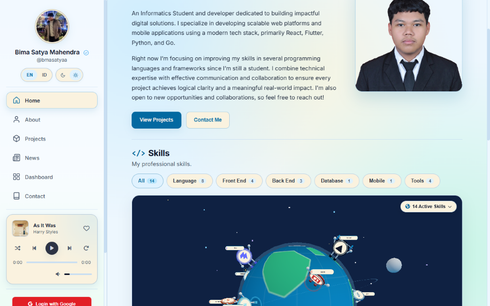
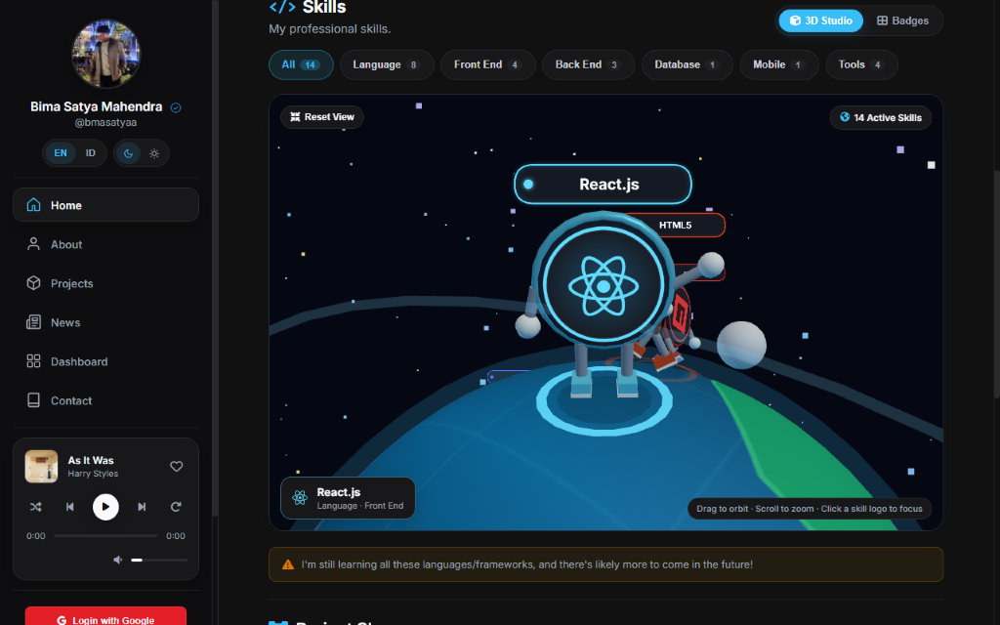
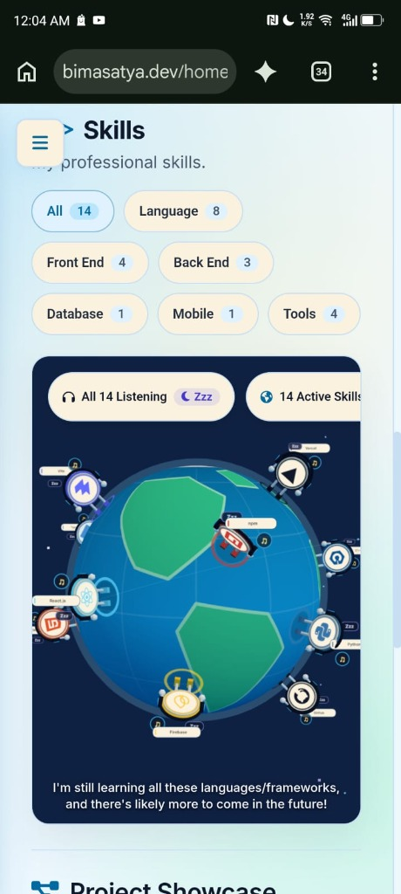
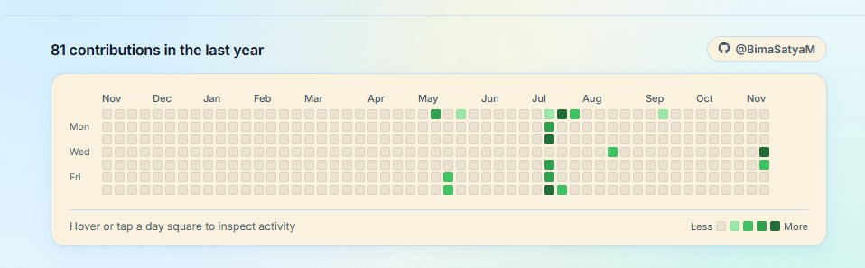
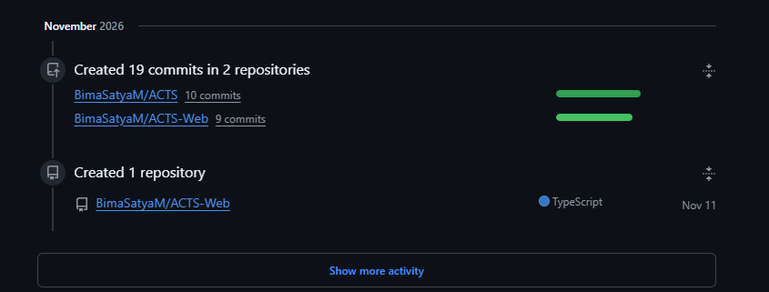

<div align="center">

# ✦ Bima Satya M.
### Interactive Personal Portfolio & 3D Web Experience

[](https://bimasatya.dev)
[](https://react.dev)
[](https://www.typescriptlang.org)
[](https://threejs.org)
[](https://vitejs.dev)
[](https://github.com/BimaSatyaM)

<br />

<p align="center">
  A modern, high-performance personal portfolio built with <b>React 19</b>, <b>TypeScript</b>, and an interactive <b>Three.js</b> orbital studio. Designed with an intentional anti-slop aesthetic, smooth animations, background music playback, and real-time GitHub activity synchronization.
</p>

<p align="center">
  <a href="https://bimasatya.dev"><strong>Explore Live Portfolio »</strong></a>
  <br />
  <a href="#-key-features">Key Features</a> •
  <a href="#-screenshot-gallery">Gallery</a> •
  <a href="#-interactive-highlights">Interactive Deep-Dive</a> •
  <a href="#-tech-stack">Tech Stack</a> •
  <a href="#-getting-started">Run Locally</a>
</p>

---



</div>

<br />

## ✦ Key Features

- **🌍 3D Skills Studio on an Interactive Earth Globe**
  - Built with custom **Three.js** shaders, Lambert materials, and shared instanced primitives for high 60fps performance on both desktop and mobile.
  - Interactive **Logoson mascots** for every skill (React, TypeScript, Three.js, Firebase, etc.) with walking, biking, car-riding, and working animations.
  - Time-aware **Jakarta Sleep Mode** (10:00 PM – 07:00 AM WIB): mascots tuck in, put on headphones, and listen to music together with floating animated `Zzz` pillows.
  - Retainable 4x ultra-HD procedural canvas textures with 8x anisotropic filtering and anti-aliasing.

- **🎵 Integrated Lo-Fi Audio Player & Synchronized Mascots**
  - Full-featured background music player with 40+ tracks, live audio equalizer visualizer, progress bar scrubbing, volume memory, and shuffle.
  - **Mascot Audio Sync**: Tap any headphone-wearing logoson to inspect its current song and hear the exact second of playback in sync with the global player.

- **📊 Live GitHub Contributions & Recent Activity Feed**
  - Real-time 369-day contribution calendar matrix synced directly with GitHub via a serverless edge proxy.
  - Anonymized private contribution support (`580+` annual contributions synced without leaking private repository code).
  - Native **Recent Activity timeline** showing recent commit rollups with repository progress bars, new repository creations with language dots, and pagination (*"Show more activity"*).

- **💼 Project Showcase & Knowledge Hub**
  - Filterable portfolio projects featuring live demos, repository links, tags, and rich descriptions.
  - Built-in news/articles section with Firebase real-time integration and admin management.

- **🎨 Anti-Slop Design & Accessibility**
  - Handcrafted **Light Cream** (`#faf7ee`) and **Dark Obsidian** (`#090d16`) color schemes.
  - Bilingual support with on-the-fly switching between **English (EN)** and **Indonesian (ID)**.
  - Fully responsive from narrow mobile viewports (`360px`) to ultrawide desktop monitors (`4K`).

---

## 📸 Screenshot Gallery

<div align="center">

### 3D Mascot Inspection & Mobile Layout

| Desktop 3D Focus & Song Inspection | Mobile Responsive Experience |
|:---:|:---:|
|  |  |

<br />

### Real-Time GitHub Contributions & Activity Feed

| 369-Day Contribution Matrix | Recent Activity Timeline |
|:---:|:---:|
|  |  |

</div>

---

## ⚡ Interactive Highlights

<details>
<summary><strong>🌍 1. Three.js 3D Architecture & Performance Optimizations</strong></summary>

<br />

- **Geometry Sharing**: All 33 3D mesh geometries (coins, limbs, headphones, bicycles, cars) and 16 base materials are instantiated once in memory and shared across all mascot workstations.
- **Fill-rate Adaptive DPR**: Dynamically scales device pixel ratio (`1.75x` – `2.25x` on mobile, up to `2.5x` on desktop) with `antialias: true` and 8x anisotropy.
- **Staggered Rasterization**: Canvas logo textures render via an asynchronous requestAnimationFrame queue (at most 2 SVGs per frame) to prevent main-thread stuttering during page load.
- **Intersection Observer Pausing**: The 3D render loop automatically idles when scrolled out of viewport or when the tab is hidden, reducing idle GPU consumption to zero.

</details>

<details>
<summary><strong>🎵 2. Audio Engine & Multi-Mascot State Machine</strong></summary>

<br />

- **AudioContext Web API**: Houses an AnalyserNode that computes live frequency spectrum energy to bounce mascot headphones, cars, and the top HUD equalizer bars in real time.
- **Decentralized Epoch Music**: Each logoson computes its own active track index and progress based on elapsed time and its workstation seed, ensuring every character enjoys distinct songs.
- **One-Click Sync**: Clicking a mascot glides the orbital camera into focus and synchronizes the global audio element directly to that character's song and timestamp.

</details>

<details>
<summary><strong>📊 3. Tokenless GitHub Edge Proxy & Activity Parser</strong></summary>

<br />

- **Zero-Secret Edge Architecture**: Operates via [`api/github-contributions.ts`](./api/github-contributions.ts) on Vercel Serverless Functions with `s-maxage=300, stale-while-revalidate=600`.
- **Private Contribution Aggregation**: Pulls public HTML fragments directly from GitHub's profile tab, safely showing your real commit count and heatmap intensity without exposing private repos or embedding sensitive GitHub tokens in client JS.
- **Infinite Month Pagination**: Clicking *"Show more activity"* queries earlier monthly ranges (`from`/`to`) on demand without page reloads.

</details>

<details>
<summary><strong>🌐 4. Bilingual Engine & Responsive Theme System</strong></summary>

<br />

- Zero external i18n bloat: uses lightweight React context ([`src/context/LanguageContext.tsx`](./src/context/LanguageContext.tsx)) with instant reactive dictionary switching between English and Bahasa Indonesia.
- Fluid CSS custom properties for instant theme toggling between Cream Paper and Night Obsidian without flash of unstyled content.

</details>

---

## 🛠 Tech Stack

| Domain | Technologies |
|:---|:---|
| **Frontend Core** | React 19, TypeScript, Vite 8, React DOM |
| **3D & Graphics** | Three.js, OrbitControls, WebGL, 2D Canvas Procedural Textures |
| **Audio & Media** | Web Audio API (AnalyserNode), HTML5 Audio, FontAwesome 6 |
| **Backend & Edge** | Vercel Serverless Functions (Node.js runtime), Firebase Firestore / Auth |
| **Styling & Motion** | Semantic CSS3, CSS Custom Properties, Fluid Typography, Micro-interactions |
| **Quality & Tooling** | Oxlint, Node Test Runner, TypeScript Compiler (`tsc -b`) |

---

## 📁 Project Structure

```text
SatyaPorto/
├── api/
│   └── github-contributions.ts     # Vercel serverless function for live GitHub calendar & activity
├── docs/
│   └── screenshots/                # HD portfolio preview captures for documentation
├── public/
│   └── assets/                     # Audio tracks, album covers, and static avatar images
├── src/
│   ├── components/
│   │   ├── skills3d/               # 3D studio, procedural earth, textures, and mascot logic
│   │   │   ├── skillWorker.ts      # Mascot character meshes, animations, and vehicles
│   │   │   ├── studioRoom.ts       # 3D Earth globe, atmosphere, moon, and starfield
│   │   │   └── textures.ts         # High-resolution procedural medallion & nameplate textures
│   │   ├── GitHubContributions.tsx # Live heatmap & recent activity timeline component
│   │   ├── SkillsRoom3D.tsx        # Main Three.js canvas stage and interactive HUD
│   │   └── Player.tsx              # Audio player controls and volume sliders
│   ├── context/
│   │   ├── AudioContext.tsx        # Global audio state & frequency analyzer
│   │   ├── AuthContext.tsx         # Firebase authentication context
│   │   └── LanguageContext.tsx     # EN / ID bilingual translations
│   ├── pages/                      # Home, About, Projects, News, Contact, and Dashboard
│   └── styles/                     # Modular CSS stylesheets (sections, base, forms, navbar)
├── tests/
│   └── github-contributions.test.ts # Unit tests for API parsers and security checks
├── vercel.json                     # Edge rewrites, serverless routing, and security headers
└── vite.config.ts                  # Vite build config with local /api dev proxy middleware
```

---

## 🚀 Getting Started

### Prerequisites
- [Node.js](https://nodejs.org) (v20 or higher recommended)
- [npm](https://www.npmjs.com) or `pnpm`

### Installation

1. **Clone the repository:**
   ```bash
   git clone https://github.com/BimaSatyaM/SatyaPorto.git
   cd SatyaPorto
   ```

2. **Install dependencies:**
   ```bash
   npm install
   ```

3. **Start the local development server:**
   ```bash
   npm run dev
   ```
   Open [http://localhost:5173](http://localhost:5173) in your browser. The local development server includes the `/api/github-contributions` middleware, so the 3D studio, audio player, and GitHub sync work out of the box!

4. **Run unit tests & linting:**
   ```bash
   # Run node unit tests
   node --test tests/github-contributions.test.ts

   # Lint with oxlint
   npm run lint

   # Type-check and production build
   npm run build
   ```

---

## 📬 Contact & Connect

- **Portfolio:** [bimasatya.dev](https://bimasatya.dev)
- **GitHub:** [@BimaSatyaM](https://github.com/BimaSatyaM)
- **Location:** Jakarta / Indonesia (WIB)

<br />

<div align="center">
  <sub>Crafted with passion, TypeScript, Three.js, and Lo-Fi beats. © 2026 Bima Satya M.</sub>
</div>
